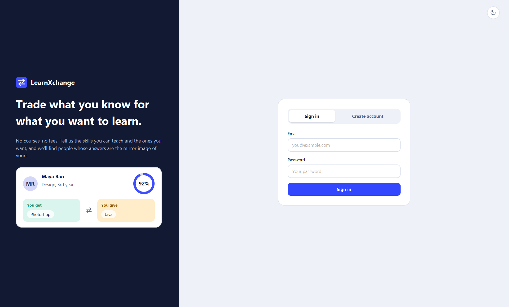
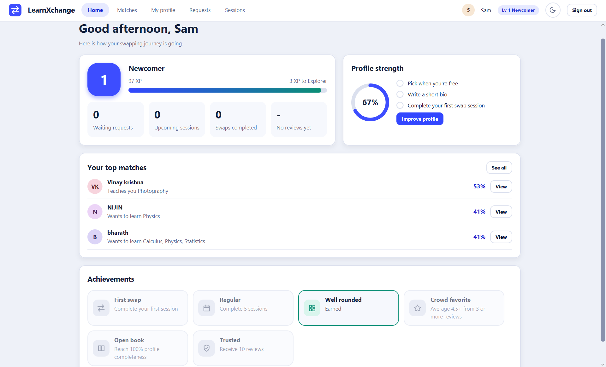
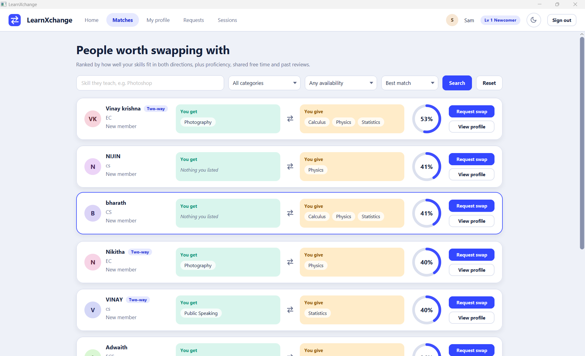

# LearnXchange -- Skill-Swap Matchmaking Platform

LearnXchange is a JavaFX desktop application that helps users exchange
skills with one another. Users can list skills they can teach, discover
skills they want to learn, find compatible learning partners, and manage
skill-exchange requests and sessions.

## Features

-   **User registration and login** with password hashing.
-   **User profiles** with name, department, bio and availability.
-   **Teach and learn skills** with proficiency levels.
-   **Skill matching** that ranks potential partners using multiple
    factors.
-   **Swap requests** to manage proposed skill exchanges.
-   **Learning sessions** to organise exchanges.
-   **Ratings and progress features** to recognise completed learning
    activities.
-   **Admin features** for managing users, the skill catalogue, reports
    and application statistics.
-   **Dark mode** for the desktop interface.

> The exact features available depend on the current state of the source
> code and database. Update this list if you have removed or changed any
> feature before publishing.

## Technology Stack

  Technology                Purpose
  ------------------------- ----------------------------------
  Java 17                   Application programming language
  JavaFX 21.0.2             Desktop user interface
  Maven                     Build and dependency management
  MySQL 8                   Relational database
  JDBC                      Database connectivity
  MySQL Connector/J 8.3.0   MySQL JDBC driver

## Matching Algorithm

LearnXchange uses a weighted matching score to rank potential
skill-exchange partners. The current weighting in `MatchingService` is:

  Matching factor            Weight
  ---------------------- ----------
  Skill fit                     35%
  Reverse skill fit             25%
  Proficiency                   20%
  Availability overlap          12%
  Rating                         8%
  **Total**                **100%**

The score considers both sides of the exchange: what one user can teach
and what the other user wants to learn. The weights are implemented in
the matching service and can be adjusted as the project evolves.

## Project Architecture

The application follows a layered structure:

``` text
JavaFX UI / Controllers
          |
          v
     Service Layer
          |
          v
      DAO Layer
          |
          v
     JDBC / MySQL
```

-   **UI and controllers:** handle screens and user interactions.
-   **Service layer:** contains application rules, validation and
    matching logic.
-   **DAO layer:** performs database operations.
-   **Database:** stores users, skills, requests, sessions, ratings and
    reports.

## Database

The application uses a MySQL database named `learnxchange`.

The database schema is provided in `schema.sql`. The schema includes
tables for:

-   `users`
-   `skills`
-   `user_skills`
-   `swap_requests`
-   `sessions`
-   `ratings`
-   `reports`

Review `schema.sql` before running it, especially if you have customised
the database structure.

## Prerequisites

Install the following before running the application:

1.  JDK 17 or a compatible newer JDK.
2.  Maven.
3.  MySQL Server 8.
4.  An IDE such as IntelliJ IDEA or Visual Studio Code (optional).

Check that Java and Maven are available:

``` powershell
java -version
mvn -version
```

## Setup and Installation

### 1. Clone the repository

``` bash
git clone https://github.com/nijin-2020/LearnXchange_application.git
cd LearnXchange_application
```

Replace `nijin-2020` with your GitHub username.

### 2. Create the database

Start MySQL and create the database:

``` sql
CREATE DATABASE learnxchange;
```

Import or execute the project's `schema.sql` file using MySQL Workbench
or the MySQL command-line client.

For example, from a terminal where the MySQL client is available:

``` bash
mysql -u YOUR_MYSQL_USERNAME -p learnxchange < schema.sql
```

### 3. Configure database credentials

A template configuration file is provided at:

``` text
src/main/resources/db.properties.example
```

Copy it to:

``` text
src/main/resources/db.properties
```

Then enter your own local MySQL connection details in `db.properties`.

Example format (use the exact property names already expected by the
project's database connection code):

``` properties
db.url=jdbc:mysql://localhost:3306/learnxchange
db.username=YOUR_MYSQL_USERNAME
db.password=YOUR_MYSQL_PASSWORD
```

**Important:** `db.properties` is a local configuration file and must
not be committed to Git. The repository's `.gitignore` should exclude
it. Never publish real passwords, API keys or other secrets.

### 4. Build and run

From the project root directory, run:

``` bash
mvn clean javafx:run
```

Maven will download the required dependencies, compile the project and
launch the JavaFX application.

## Screenshots

Add screenshots captured from the actual running application to a folder
named `screenshots/`. Then update the image paths below to match the
filenames you add.

``` text
screenshots/
├── login.png
├── dashboard.png
├── profile.png
└── matching.png
```

### Login



### Dashboard




### Skill matching



If you have not added these screenshots yet, remove the image links
temporarily or add the real images before publishing the README.

## Repository Structure

The main project files are organised approximately as follows:

``` text
LearnXchange/
├── src/
│   ├── main/
│   │   ├── java/
│   │   │   └── com/learnxchange/
│   │   └── resources/
│   │       └── db.properties.example
│   └── test/
├── screenshots/
├── schema.sql
├── pom.xml
├── README.md
└── .gitignore
```

The exact package and class structure may vary as the project develops.

## Security Notes

-   Do not commit `src/main/resources/db.properties`.
-   Do not include real database passwords, API keys or personal
    information in source code, screenshots or documentation.
-   Use `db.properties.example` with placeholder values to show the
    expected configuration format.
-   Use prepared statements for SQL queries that include user input.
-   Keep administrator access restricted to authorised accounts.
-   If a credential has ever been pushed to a public repository, treat
    it as exposed: rotate or revoke it where appropriate. Removing the
    file in a later commit does not remove it from earlier Git history.

## Future Improvements

Potential areas for future development include:

-   Automated tests for services and matching logic.
-   Improved profile discovery and matching filters.
-   Notifications for swap requests and upcoming sessions.
-   More detailed learning-progress analytics.
-   Improved accessibility and interface responsiveness.

Only keep items in this section that are genuinely planned or not yet
implemented.

## Author

**NIjin K Biju**

-   GitHub:
    [Nijin-2020](https://github.com/Nijin-2020)

Replace the placeholders above with your details before publishing.

## License

Choose and add a license if you want to specify how others may use,
modify and distribute this project. For example, an MIT License can be
added in a separate file named `LICENSE`. Do not claim that the project
is MIT-licensed unless you have added that license and intend to use it.
